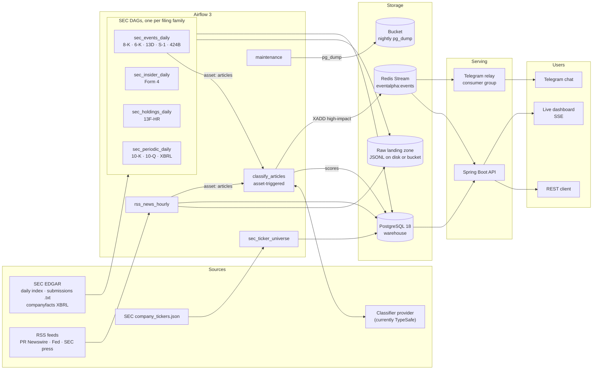
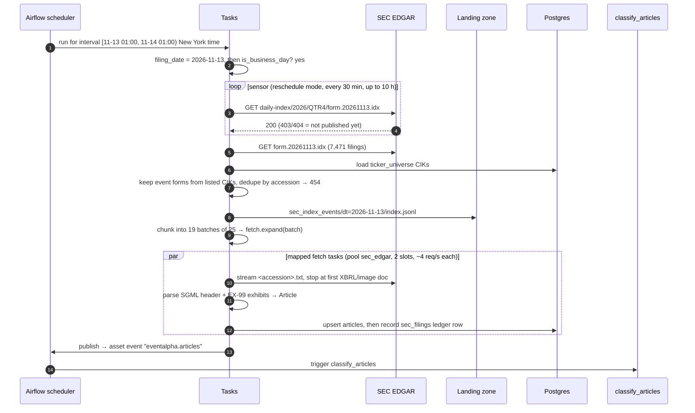
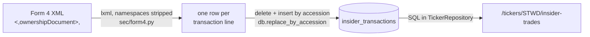
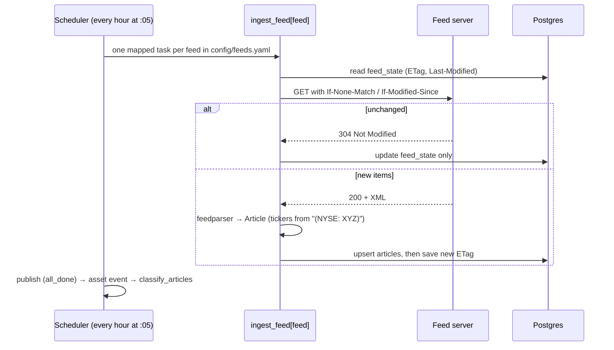
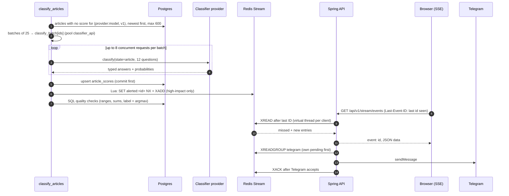
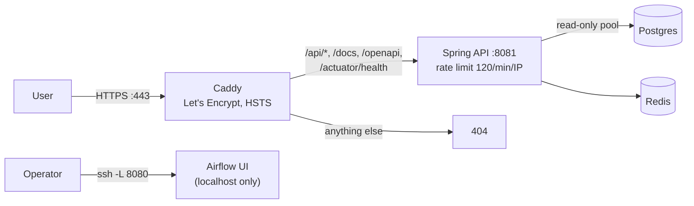
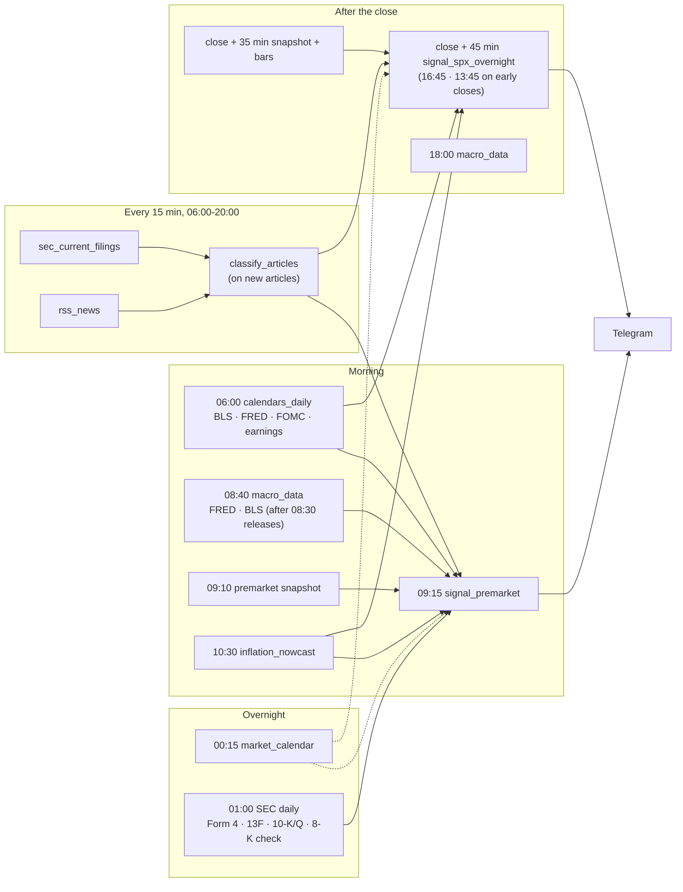

# EventAlpha data flow

How data moves from SEC EDGAR and RSS feeds, through Airflow and the warehouse, to what a
user sees in the API, the live stream, and Telegram. Diagrams are Mermaid (rendered by
GitHub). Example values are real rows from the 2026-11-13 run unless marked *illustrative*.

Related: [ARCHITECTURE.md](ARCHITECTURE.md) (components and decisions),
[SYSTEM_DESIGN.md](SYSTEM_DESIGN.md) (requirements, scale, failure modes).

## 1. The whole picture



## 2. Where each source ends up

| Source | DAG | Landing file | Warehouse tables | User-facing |
|---|---|---|---|---|
| `company_tickers.json` | `sec_ticker_universe` | n/a | `ticker_universe` | ticker on every row |
| 8-K, 6-K, Schedule 13D(/A), S-1, 424B4/5 | `sec_events_daily` | `sec_index_events/dt=…/index.jsonl` | `articles` → `article_scores` | `/articles`, `/events`, `/tickers/{t}/sentiment`, SSE, Telegram |
| Form 4(/A) | `sec_insider_daily` | `sec_index_insider/…` | `insider_transactions` | `/tickers/{t}/insider-trades` |
| 13F-HR(/A) | `sec_holdings_daily` | `sec_index_holdings/…` | `institutional_filings`, `institutional_holdings` | (planned 13F visuals) |
| 10-K / 10-Q + XBRL | `sec_periodic_daily` | `sec_index_periodic/…` | `report_sections`, `financial_facts` | (planned) |
| RSS feeds | `rss_news_hourly` | `rss_<feed>/dt=…/<run>.jsonl` | `articles` (+ `feed_state`) | same as articles |
| every SEC filing processed | all SEC DAGs | n/a | `sec_filings` (ledger) | `/status/sec` |

## 3. One SEC family run, step by step

Each of the four SEC DAGs runs this sequence once per filing date. Shown for
`sec_events_daily` on filing date 2026-11-13 (run at 2026-11-14 01:00 ET).



## 4. Following one filing end to end (AAON 8-K)

**Stage 1. Daily index line** (`form.20261113.idx`, fixed width):
```
8-K              AAON, INC.                                    824142      20261113    edgar/data/824142/0001628280-26-073758.txt
```

**Stage 2. Landing zone record** (`data/raw/sec_index_events/dt=2026-11-13/index.jsonl`):
```json
{"form_type": "8-K", "company": "AAON, INC.", "cik": "824142", "date_filed": "2026-11-13",
 "path": "edgar/data/824142/0001628280-26-073758.txt"}
```

**Stage 3. Submission parsed** (`sec/submission.py`, `sec/events.py`). From the SGML header:
```
ACCESSION NUMBER:      0001628280-26-073758
<ACCEPTANCE-DATETIME>  20261113151630            → 2026-11-13 15:16:30 America/New_York
ITEM INFORMATION:      Entry into a Material Definitive Agreement   → item 1.01
ITEM INFORMATION:      Financial Statements and Exhibits            → item 9.01
```
Body = text of the EX-99 exhibits (the press release), HTML stripped, capped at 20,000 chars.
Streaming stopped before the XBRL and image documents: about 1.3 MB read of a 2.1 MB file.

**Stage 4. Warehouse rows**

`articles`:
| id | source | source_id | form_type | title | tickers | sec_items | published_at |
|---|---|---|---|---|---|---|---|
| 154 | sec_edgar | 0001628280-26-073758 | 8-K | AAON, INC. 8-K: Entry into a Material Definitive Agreement | {AAON} | {1.01,9.01} | 2026-11-13 20:16:30+00 |

`sec_filings` (ledger):
| accession | family | form_type | cik | date_filed | status | rows |
|---|---|---|---|---|---|---|
| 0001628280-26-073758 | events | 8-K | 824142 | 2026-11-13 | loaded | 1 |

**Stage 5. Classification** (`classify_articles` → `eventalpha.classification`). One provider request whose
state is the article with context, answering 12 questions at once. *Illustrative* result,
since classification hasn't run on real data yet:
```
article_scores: article_id=154, model=typesafe:jev-1.14.0, questions_version=v1,
  sentiment=bullish, p_bullish=0.62, p_bearish=0.08, p_neutral=0.30, sentiment_score=0.54,
  materiality=1.9, company_specific=0.97,
  events={"capital_raise": 0.81, "m_and_a": 0.04, "earnings_results": 0.02, ...}
```

**Stage 6. Live event?** Published to the Redis Stream only if `materiality ≥ 2.5` and
`company_specific ≥ 0.8`. With the illustrative scores above (materiality 1.9) it would **not**
be published. A guidance cut scored 2.8 would be:
```
XADD eventalpha:events MAXLEN ~ 10000 *  article_id 154  tickers AAON  form_type 8-K
     sentiment bearish  sentiment_score -0.850  materiality 2.80  events guidance_lowered ...
```

**Stage 7. What the user sees.** `GET /api/v1/articles?ticker=AAON&days=30&limit=1` (real
response, before classification):
```json
{
  "data": [{
    "id": 154, "source": "sec_edgar", "formType": "8-K",
    "title": "AAON, INC. 8-K: Entry into a Material Definitive Agreement",
    "url": "https://www.sec.gov/Archives/edgar/data/824142/000162828026073758/0001628280-26-073758-index.htm",
    "company": "AAON, INC.", "tickers": ["AAON"], "secItems": ["1.01", "9.01"],
    "publishedAt": "2026-11-13T20:16:30Z",
    "score": null
  }],
  "dataAsOf": "2026-11-14T22:17:22.473914Z",
  "generatedAt": "2026-11-14T22:42:25.426272383Z"
}
```
`score` fills in once classification runs; `dataAsOf` shows when the data last changed.

## 5. A structured filing: Form 4 open-market purchase

No language model is involved: XML goes straight to rows.



Real row (`insider_transactions`, accession 0000905148-26-004805):
| ticker | owner_name | officer_title | code | shares | price | transaction_date |
|---|---|---|---|---|---|---|
| STWD | STERNLICHT BARRY S | CEO, Chairman of the Board | P | 830,000 | 11.9146 | 2026-11-11 |

Real API summary (`/api/v1/tickers/STWD/insider-trades?days=30&openMarketOnly=true`):
```
trades=4, openMarketBuys=4, openMarketSells=0, netOpenMarketValue=16,711,131.60
```

## 6. RSS path



## 7. Classification and live delivery



## 8. Request path from the internet (production)



## 9. A trading day, and what feeds each signal



Dotted lines: the session calendar decides whether (and, on early closes, when) a signal runs.

## 10. Freshness at each hop

| Hop | Typical delay |
|---|---|
| Company files with SEC → appears in that day's index | same evening (index published ~22:00 ET) |
| Index → `articles` / `insider_transactions` / … | next run at 01:00 ET (+ fetch time, ~30 min on a heavy day) |
| RSS item published → `articles` | ≤ 1 hour (hourly at :05) |
| `articles` → `article_scores` | minutes (asset-triggered) |
| Score → Redis Stream → SSE client | < 1 s (SSE polls every second when idle) |
| Score → Telegram | ~2 s (relay loop) |
| After-hours 8-K accepted → in the 16:45 signal | ≤ 15 min (intraday feed) + classification |
| 08:30 BLS release → in the 09:15 signal | 10 min (macro_data at 08:40) |
