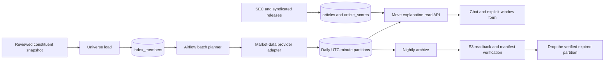

# Intraday data and move explanations

EventAlpha accepts a ticker and a time window, compares available stock and benchmark prices,
and links the original sources behind plausible drivers. Collection and archival preserve
when information first reached the system, so retrospective explanations can be distinguished
from an as-of replay.

## Collection and read paths



The collector is `market_move_bars`. The archive task is
`maintenance.archive_minute_candles`. Both use the existing warehouse connection and Airflow
retry policy.

## Universe and request budget

`src/eventalpha/marketdata/universe.py` uses only the reviewed checked-in
`config/index_members.json` snapshot (S&P 500, Nasdaq-100 and Dow 30; see the README). The snapshot records provenance and observation date.
It contains 101 Nasdaq-100 listings and 503 S&P 500 listings, deduplicated to 521 symbols
including SPY, QQQ and SMH. There are no automatic publisher requests or browser impersonation.
An operator must review membership changes and replace the snapshot in a pull request.
`index_members` records the snapshot membership and its original `fetched_at`.
Malformed snapshots fail explicitly rather than replacing the stored membership partially.

The DAG creates required partitions before mapping collection tasks. It divides the symbol set into batches of 25, with at most two active batch
tasks. Each worker waits until at least 1.5 seconds has elapsed for a symbol request cycle.
The provider's existing retry logic handles transport failures and retryable HTTP responses.

A new symbol receives eight calendar days of completed regular-session bars. Incremental
requests start an hour before the newest stored bar, bounded by the same eight-day floor.
The overlap recovers recent holes. Collection uses the previous completed minute with a
publication buffer. A response outside the requested bounds is discarded.

Symbols are stored using SEC spelling. For example, BRK-B is requested from the provider as
BRK/B. Index membership can contain multiple share classes of the same company.

## Minute-candle storage

| Field | Meaning |
|---|---|
| `symbol` | Canonical stock or benchmark symbol |
| `started_at` | Candle opening time, stored with a UTC offset |
| `open`, `high`, `low`, `close` | Decimal prices |
| `volume` | Reported volume, nullable when unavailable |
| `first_seen_at` | Time this observation was first inserted into the warehouse |

The primary key is `(symbol, started_at)`. High, low and volume are nullable for observations
collected before those fields were added. Inserts preserve an existing observation on conflict.
Large initial loads are split into SQL batches within a per-symbol transaction.

The parent table is partitioned by `RANGE (started_at)`. A child named
`price_bars_minute_p20261118` covers the half-open interval from
`2026-11-18T00:00:00Z` through `2026-11-19T00:00:00Z`. Explicit UTC bounds prevent database
session time zones from shifting a partition.

The planner creates the recent collection range and seven future days. Nightly maintenance
also creates future partitions. Creation is serialized by a transaction-scoped advisory lock.
Alembic models the parent and excludes managed child tables from autogenerate comparison.

The migration copies existing observations into the new partitioned parent and drops the
legacy table after the copy. Run this migration before the expanded backfill. A default
partition catches unexpected historical or future inserts. Its expected row count is zero.

`price_bars_daily` retains its existing schema and storage behavior.

## Window resolution and prices

The explicit form sends offset-aware timestamps. Date pickers use the displayed browser time
zone. Chat resolves supported relative phrases through the same read API.

| Phrase | Resolved window |
|---|---|
| Today | New York regular-session open through the current minute, capped at session close |
| Since yesterday | Previous trading session's close through the current minute |
| Since yesterday's open | Previous trading session's open through the current minute |
| Last 30 minutes or last hour | A minute-aligned relative window ending at the current minute |

Trading-session resolution uses `market_sessions` and handles closed days and early closes.
Missing calendar coverage produces a message asking for an explicit window. The chat displays
only the latest question and answer while retaining ticker and window context for a follow-up.

The start uses the last available completed candle strictly before the requested start.
At least one closing candle must start inside the window; an opening observation alone never
produces a measured zero return.
The end uses the last available completed candle at or before the requested end.

```text
return_percent = 100 * (end_price - start_price) / start_price
```

The ticker, SPY and SMH share the requested window, but sparse series may have different
actual measurement times. The UI displays each symbol's measured boundaries and observation
time. Missing valid opening data omits that series. Selection looks back at most seven days.

SEC filings and PR Newswire releases qualify as plausible drivers when their latest eligible
classification is material and company-specific. The timeline retains available matching
sources even when none qualifies. Evidence published after the move is labeled as later
context. Replay filters publication, ingestion, article-version, score, and review timestamps
through the cutoff. Candle first-seen times are filtered through that cutoff as well.

The chat currently uses a guided phrase parser. The read API returns structured results with
source links and timing, allowing another client to consume the same interpretation.

## Retention and archive protocol

The existing maintenance DAG runs nightly at 04:30 New York time. It considers complete UTC
partitions whose date is earlier than UTC today minus fourteen days. Whole-day eligibility
keeps the current UTC day and fourteen preceding dates in the warehouse. An eligible partition
is reclaimed on a successful nightly run.

Archive layout uses the configured prefix.

```text
s3://<bucket>/<prefix>/dt=YYYY-MM-DD/part-<sha256>.jsonl.gz
s3://<bucket>/<prefix>/dt=YYYY-MM-DD/_manifest.json
```

JSONL preserves decimal prices as strings, volume as an integer or null, and both timestamps
as strings with offsets. The manifest records the schema version, table, UTC date, object key,
SHA-256 checksum, row count, column names, and export time.

For each eligible partition the offloader performs the following sequence.

1. Take a share lock on the child partition for a consistent export.
2. Stream its rows in deterministic symbol/time order into a compressed temporary file, then release the lock.
3. Upload the object under its content checksum.
4. Download it and verify the checksum, row count, and UTC date of every candle.
5. Write the manifest and read it back to verify its exact contents.
6. Acquire the maintenance advisory lock and parent lock, compare the SQL row count and newest first-seen time, and drop only if unchanged.

S3 upload, download, and manifest operations run outside database transactions. The final
transaction takes the parent lock before inspecting the child, avoiding inverted lock order.
A five-second lock timeout bounds lock acquisition. An insert during transfer causes the final snapshot
comparison to fail and keeps the partition for retry. Failed verification retains all rows.
Concurrent detach is not used because the parent has a default partition.

Partition creation atomically moves overlapping default rows into the dated table before
attaching it. Before discovery, archival creates dated partitions for every UTC date present in the default
partition, including dates outside the collector's range.
Daily candles are never archived by this path.

## Configuration and operating checks

| Setting | Behavior |
|---|---|
| `MINUTE_ARCHIVE_BUCKET` | Archive destination, falling back to `RAW_BUCKET` |
| `MINUTE_ARCHIVE_PREFIX` | Defaults to `minute_bars` |
| `AWS_DEFAULT_REGION` | Region used by the standard AWS client configuration |
| AWS credentials or role | S3 PutObject and GetObject access for the archive prefix |

A local deployment sharing the production bucket uses `minute_bars/local`. Production keeps
`minute_bars`. Their manifests have separate keys. Credentials belong in ignored environment
configuration or a runtime role.

With no bucket configured, the task reports a skip and retains all rows. Archive errors follow
the existing Airflow failure and retry behavior. The maintenance task's return value identifies
the bucket, prefix, and successfully archived days.

Useful checks include the following queries.

```sql
SELECT relkind
FROM pg_class
WHERE oid = 'price_bars_minute'::regclass;

SELECT tableoid::regclass AS partition, count(*)
FROM price_bars_minute
GROUP BY tableoid
ORDER BY tableoid::regclass::text;

SELECT count(*) FROM price_bars_minute_default;

SELECT count(DISTINCT symbol), min(started_at), max(started_at)
FROM price_bars_minute;
```

The parent reports `relkind = 'p'`. Rows should appear in dated children, with zero default
rows. Daily-candle counts can be compared before and after a minute migration or offload.

## Verification

PostgreSQL tests cover migration upgrade/downgrade and row preservation, metadata alignment,
retention boundaries, first-seen preservation, successful archive readback, corruption refusal,
production/local prefix separation, and survival of daily-candle rows. Universe tests cover snapshot deduplication, share-class symbols, unchanged-row preservation,
and collection without publisher requests. Tests also cover
default-partition repair and a late insert during network transfer without blocking ingestion.

Live checks also exercise the configured S3 credentials with a small temporary write/read/checksum
round trip and remove that check object. Running the retention task while no partitions are old
enough verifies configuration without reclaiming candle data.

The architectural choice is recorded in [ADR 0006](adr/0006-partitioned-minute-candles-and-s3-archives.md).

## Discovery leads

There is no live X search integration. Leads are manually reviewed through
`uv run python -m eventalpha.sources.x_review record --help` and `verify --help`.
The record command accepts only a post ID, ticker, publication time and reviewer-written
paraphrase. First-seen time is assigned by PostgreSQL, never supplied retrospectively.
Verification requires a supporting passage from an original already ingested by SEC/RSS.
The command never fetches X, stores raw post text or adds posts to training data.
Operators must have permission to use the information they enter. Automated X collection
requires a separate provider implementation and review against the then-current official API
terms; this manual boundary does not claim to authorize scraping or redistribution.

## Price boundaries

Returns use the close of the last completed candle before the start and the last completed
candle at or before the end, bounded to seven days of lookback. Each returned symbol includes
`measuredStart`, `measuredEnd`, and `dataAsOf` (when both observations were available).
The UI displays those times because collection can lag or boundaries can fall outside sessions.
Replay requires each selected bar's first-seen timestamp to be no later than the cutoff.
After-window articles remain context and cannot become catalysts.

## Migration compatibility

Keep both minute-bar revisions: the initial unpartitioned table revision and the later
partition conversion. Development has applied both. Production's revision could not be
confirmed during review, so published migration IDs are preserved. Fresh installations apply
both in order; existing installations retain their upgrade path without rewriting history.

### Snapshot and demo maintenance

Unchanged constituent snapshot timestamps and row counts leave membership rows untouched.
Publisher URLs and spreadsheet parsers are removed; snapshot updates require a reviewed edit
of `config/index_members.json` (via `scripts/refresh_index_members.py`) with its provenance and observation timestamp.

The shared demo fixture is `web/src/fixtures/move-demo.json`. Both UI bounds and the generated
SQL seed derive from it. Run `python scripts/render_move_demo.py` after editing it; the fixture
synchronization test rejects a stale seed. The API supplies comparison benchmark symbols,
and chat and the picker use the same explanation-fetch helper.

The archive's final SQL count/newest-observation check relies on insert-only candle writes.
Administrative corrections must pause archival; in-place updates with unchanged observation
times are outside this invariant. Parent locking covers the SQL check and drop only, with no
Python serialization or network calls. Default-row repair is atomic and retains first-seen times.
