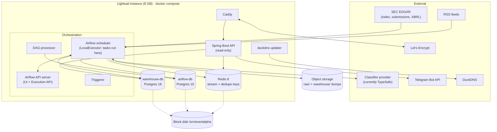
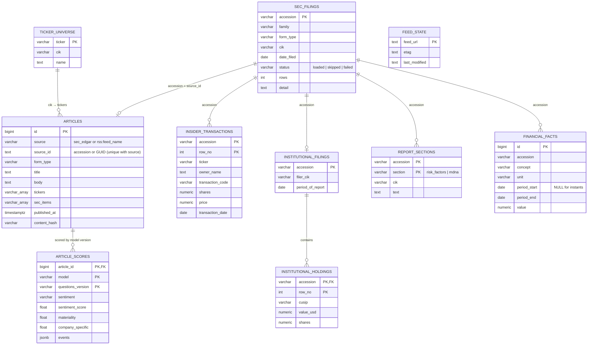

# EventAlpha system design

Requirements, scale estimates, components, data model, failure handling and the scaling
path. See [DATA_FLOW.md](DATA_FLOW.md) for diagrams of the data moving through the system,
[ARCHITECTURE.md](ARCHITECTURE.md) for the repo layout, and [DEPLOY.md](DEPLOY.md) for operations.

## 1. Problem

Corporate events (earnings, guidance changes, M&A, activist stakes, insider buying, offerings)
are disclosed first in SEC filings and press releases. EventAlpha collects them daily,
turns the text into structured signals (sentiment, materiality, event type), and makes
them queryable and pushable for next-day trading research.

**Goals**
* Every relevant SEC filing for a trading day, parsed into tables, by the next pre-market
* Text events classified with calibrated probabilities, not just labels
* Re-runnable history: any day can be rebuilt without duplicates
* High-impact events pushed live to subscribers
* Runs for about $50 a month, operated by one person

**Non-goals**
* Intraday or minute-level reaction trading (news-to-price at that horizon is mostly noise)
* Order execution or portfolio management
* Scraping sites whose terms forbid it

## 2. Requirements

| Functional | |
|---|---|
| F1 | Ingest 8-K, 6-K, Schedule 13D(/A), S-1, 424B4/5, Form 4, 13F-HR, 10-K/10-Q + XBRL facts per filing date |
| F2 | Ingest press-release and macro RSS feeds hourly |
| F3 | Classify each text event: sentiment (3-way), materiality (0–3), 9 event types, company-specific |
| F4 | Serve articles, events by type, ticker sentiment by day, insider trades, ingestion status |
| F5 | Push high-impact events live (SSE) and to Telegram |
| F6 | Backfill any date range |
| F7 | Two Telegram signals on trading days: 09:15 ET premarket (ticker-specific + macro) and 15 min before the SPX session ends (market-wide, for the overnight SPX session) |
| F8 | Market data, macro series, release/earnings calendars and inflation nowcasts from official or licensed sources |

| Non-functional | Target |
|---|---|
| Freshness | Filing date D available by D+1 ~02:00 ET; RSS ≤ 1 h; live events < 5 s after scoring |
| Correctness | Idempotent loads; every filing accounted for in a ledger (loaded / skipped / failed) |
| External limits | SEC ≤ 10 req/s with a contact User-Agent; classifier provider rate limits |
| Availability | Single host, best effort; daily job may slip hours, never silently skip a day |
| Recovery | Nightly backups, 30-day retention; any day re-derivable from SEC |
| Cost | ≈ $50/month infrastructure + cents/day of classifier usage |
| Security | Only the read API is public; no write path from the internet |

## 3. Scale estimates

From the 2026-11-13 run (a 13F deadline day, so near peak):

| Quantity | Per day | Per year (≈250 trading days) |
|---|---|---|
| Filings in SEC daily index | 7,471 | ~1.9 M |
| Event filings kept (listed issuers) | 454 | ~110 k articles |
| Form 4 kept → transactions | 669 → 1,488 | ~375 k rows |
| 13F-HR → holdings rows | 1,087 → 506 k (deadline) | ~15–20 M rows (4 deadline clusters) |
| 10-K/10-Q → sections / facts | 416 → 688 / 11,337 | ~2–3 M facts (earnings-season peaks) |
| SEC HTTP requests | ~3–4 k | — |
| Classifier input tokens (≈5 k per article) | ~3 M | ~$0.13/day at the current provider's $0.042 per 1 M |

**Storage:** article bodies (≤ 20 KB) ~2.5 GB/yr, 13F holdings ~3 GB/yr with indexes,
sections ~1.5 GB/yr, everything else < 1 GB, so **~8 GB/year**. The 64 GB data disk covers
several years.

**Throughput:** 2 pool slots × 4 req/s = 8 req/s → ~4,000 requests in ~8–10 minutes plus
transfer time. The heavy day finished in ~30 minutes on a laptop, well within the window.

## 4. High-level design

## 5. Components

| Component | Responsibility | Key choices |
|---|---|---|
| **Airflow 3** | Scheduling, retries, backfills, dependencies | LocalExecutor on one host; DAG files only wire tasks; pools for external rate limits; assets for data-driven triggers |
| **SEC DAGs** (×4, generated) | Per filing family: wait for index → list → fetch in mapped batches → load → ledger | `CronDataIntervalTimetable` (interval = filing date); sensor in reschedule mode |
| **RSS DAG** | Hourly feeds, one mapped task per feed | Conditional GET; `all_done` publish so one bad feed doesn't block the rest |
| **classify_articles** | Score unscored articles through the classifier interface, check quality, publish high-impact events | Work queue keyed on (model, questions_version); asyncio + semaphore; SQL check operators |
| **maintenance** | Backups, `airflow db clean`, log pruning, disk alert | `pg_dump -Fc` (zstd) to bucket with retention |
| **Warehouse (Postgres 18)** | System of record for everything derived | Alembic-owned schema; natural-key upserts; ledger table |
| **Redis 8** | Durable event fan-out | Stream + consumer group; AOF; `noeviction` |
| **Spring Boot API** | Read endpoints, SSE stream, Telegram relay | JdbcClient + explicit SQL; read-only pool; virtual threads; per-IP rate limit; `dataAsOf` on every response |
| **Caddy** | TLS termination and path allow-list | Automatic Let's Encrypt; only `/api`, docs, health are proxied |

## 6. Data model

Relationships to `sec_filings` and `ticker_universe` are logical (matched on accession / CIK),
not foreign keys: a filing is loaded before or alongside its ledger row, and the universe
changes over time.

**Keys and idempotency**

| Table | Natural key | Load strategy |
|---|---|---|
| `articles` | (source, source_id) | upsert; update only when `content_hash` changes |
| `article_scores` | (article_id, model, questions_version) | upsert; new model or questions → new rows |
| `insider_transactions`, `institutional_holdings`, `report_sections`, `financial_facts` | accession (+ row/section/fact) | delete-and-insert per accession in one transaction (amendments can drop lines) |
| `institutional_filings`, `sec_filings`, `ticker_universe`, `feed_state` | accession / ticker / URL | upsert |

## 7. API

| Endpoint | Purpose | Notes |
|---|---|---|
| `GET /api/v1/articles?ticker&source&formType&days&limit` | Recent articles with their latest score | Latest score = `DISTINCT ON (article_id) … ORDER BY scored_at DESC` |
| `GET /api/v1/events?type&minProb&ticker&days` | Articles where the classifier flags an event type | Filters on `events ->> type` |
| `GET /api/v1/tickers/{t}/sentiment?days` | Daily sentiment by US/Eastern date | Counts, mean, materiality-weighted score |
| `GET /api/v1/tickers/{t}/insider-trades?days&openMarketOnly` | Form 4 rows + net open-market value | P minus S; awards and tax withholding excluded |
| `GET /api/v1/status/sec?days` | Ledger roll-up per date and family | loaded / skipped / failed counts |
| `GET /api/v1/stream/events` | SSE live feed | Resumes from `Last-Event-ID`; 100-client cap |

Every JSON response: `{ data, dataAsOf, generatedAt }`. Errors: RFC 9457 problem details.
Rate limit: 120 requests/min/IP on `/api/**` (429 + `Retry-After`).

## 8. Key decisions and alternatives

| Decision | Chosen | Alternatives considered | Why |
|---|---|---|---|
| Orchestrator | Airflow 3 | cron + scripts, Dagster, Prefect | Backfills, retries, pools, assets, UI; the target role uses Airflow |
| Executor / hosting | LocalExecutor, one VM | Celery/Kubernetes executor, MWAA, Cloud Composer | ~$50/mo vs $200–400+; DAG code unchanged if scaled later |
| Warehouse | Postgres 18 | ClickHouse, DuckDB on Parquet | Volumes are small; transactional upserts; one store to operate |
| Event delivery | Redis Streams | Postgres LISTEN/NOTIFY, Kafka | NOTIFY drops events for offline consumers; Kafka is overkill on one host |
| Classifier | Provider-neutral interface; TypeSafe today (typed answers) | Free-text LLM, FinBERT, Google decision APIs | Probabilities per label, no output parsing, cheap; the interface keeps switching to one module |
| API data access | JdbcClient + SQL | JPA/Hibernate | Read-only, query-shaped; explicit SQL is clearer |
| Public ingress | Caddy + DuckDNS | Tailscale Funnel, Cloudflare tunnel, load balancer | Real TLS on a stable name for free; one-line move to a bought domain |
| Deploys | Laptop script with image tags | CI deploy over SSH | SSH open only to one IP; rollbacks are `deploy.sh <sha>` |
| Sources | SEC + syndicated RSS | Scraping Barchart / Benzinga / Yahoo | Terms of service; public project |
| Calendars | BLS iCal + FRED (exact names) + Fed FOMC page; Tradier corporate calendar | yfinance, ForexFactory `faireconomy` | Official / licensed; cost: no consensus forecasts, so CPI surprise uses the Cleveland Fed nowcast |
| Early closes | Schedule both 16:45 and 13:45 (`MultipleCronTriggerTimetable`) + a calendar gate | Custom timetable plugin; skip early-close days | Simple, testable, uses the broker's own calendar |
| Signal timing | Fixed clock times, report freshness | Wait for upstream DAGs | The alert must arrive before the trade window closes |

## 9. Failure modes

| Failure | Detection | Behaviour / recovery |
|---|---|---|
| SEC index late | sensor keeps checking | Waits up to 10 h without holding a worker; holiday → soft-fail skip |
| SEC 429 / 5xx | HTTP status | Client retries with backoff (before the first byte when streaming); Airflow retries the task |
| One filing unparseable | exception in batch | Ledger `failed` with reason; batch continues; batch fails only if > 50% fail |
| SEC changes a form name / XML | 0 filings or many `skipped` | Planned: zero-volume alert and unknown-form report |
| Classifier outage / 429 | `ClassifierError` | Provider SDK retries; failed articles stay unscored and are picked up next run |
| Task killed mid-load | task failure | Retry, or `airflow backfill create --reprocess-behavior failed`; loads are idempotent |
| Redis down | API health DOWN; publish errors | Scores stay in Postgres; events not pushed until Redis returns (articles remain queryable) |
| Telegram API errors | relay exceptions | Entry stays pending in the consumer group, retried with backoff; acked only on success |
| Postgres down | every task / API call | Tasks retry; restore from nightly dump if data is lost; any day re-derivable from SEC |
| Disk filling | maintenance DAG | Telegram alert at 80%; log pruning and `airflow db clean` nightly |
| Whole host lost | healthchecks.io missed ping | New instance from Terraform, attach data disk (or restore dump), redeploy a tag |
| Tradier calendar can't serve next year | refresh stops at the year boundary | January loads on the first nightly refresh of the new year; the gate also refreshes on a missing day |
| Inputs late at signal time | `inputs_as_of` per input, unscored count | Signal still goes out, states what's stale |
| Bad deploy | health check in `deploy.sh` | Roll back with `deploy.sh <previous sha>`; migrations are backward-compatible |

## 10. Consistency

* **Postgres is the source of truth.** Redis holds only derived notifications; events are
  published *after* the score commit, so a consumer never sees an event the API can't serve.
* **At-least-once everywhere, made effectively-once by keys:** retried tasks re-upsert the
  same keys; the stream publish is guarded by `SET NX` in the same Lua script as `XADD`;
  Telegram is at-least-once (a crash between send and ack can repeat one message).
* **Time:** SEC timestamps are stored as UTC `timestamptz`; daily aggregates bucket by
  `America/New_York` date (the trading day). Schedules are written in New York time
  (`AIRFLOW__CORE__DEFAULT_TIMEZONE`), so jobs keep the same Eastern time across daylight saving.

## 11. Security

* Only Caddy listens publicly (80 for the ACME challenge and redirect, 443). SSH is
  restricted to the operator's IP; the Airflow UI binds to loopback (SSH tunnel).
* The API's DB pool is read-only; there's no write endpoint.
* Secrets live in a git-ignored `.env.production`, written to the host with `umask 077`.
* Bucket credentials are a bucket-scoped key, not account credentials.
* Containers run as non-root (Airflow uid 50000, API uid 10001).
* Classifier answers are typed (labels and probabilities), so article text can't inject into code paths.

## 12. Observability

| Signal | Where |
|---|---|
| Task failures (after last retry) | Telegram via `on_failure_callback` |
| Daily pipeline heartbeat | healthchecks.io ping from `sec_events_daily` |
| Coverage per day and family | `sec_filings` ledger, `/api/v1/status/sec` |
| Data quality | SQL check tasks in `classify_articles` |
| Freshness | `dataAsOf` on API responses |
| Service health | `/actuator/health` (DB + Redis), compose health checks |
| Logs | Airflow task logs (pruned at 30 days), JSON Caddy access logs, rotated container logs |

## 13. Scaling path

| Pressure | First step | Next step |
|---|---|---|
| More DAGs / tasks than one host can run | CeleryExecutor with workers on a second host (Redis already present as broker) | KubernetesExecutor or MWAA / Cloud Composer |
| SEC throughput | Already capped by SEC at 10 req/s: raise pool slots to the limit | Spread backfills over time |
| Classifier volume | Raise `classifier_api` slots within the provider's rate limit | Batch fewer questions for low-value sources |
| Warehouse size (13F history) | Partition `institutional_holdings` by `period_of_report` | Move 13F analytics to a columnar store (ClickHouse / Parquet + DuckDB) |
| API traffic | Several API replicas behind Caddy; move the rate limiter to Redis | Response cache invalidated by the `article_scores` asset |
| Live subscribers | Raise the client cap (virtual threads are cheap) | Blocking XREAD with a shared reader and an in-process fan-out |

## 14. Known limitations

* Survivorship bias: today's ticker list is used for historical dates.
* 13F is keyed by CUSIP; no free official CUSIP → ticker map.
* 10-K/10-Q section extraction depends on item headings.
* Single host: maintenance windows and host loss mean downtime (data is recoverable).
* Alert thresholds (materiality ≥ 2.5, company-specific ≥ 0.8) are untuned until there's
  labelled data and the next-day-return evaluation.
